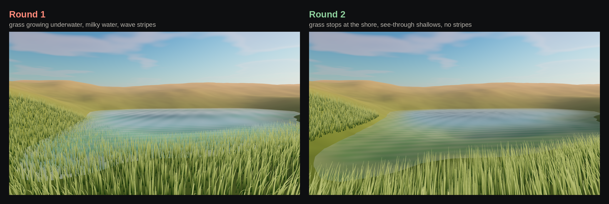
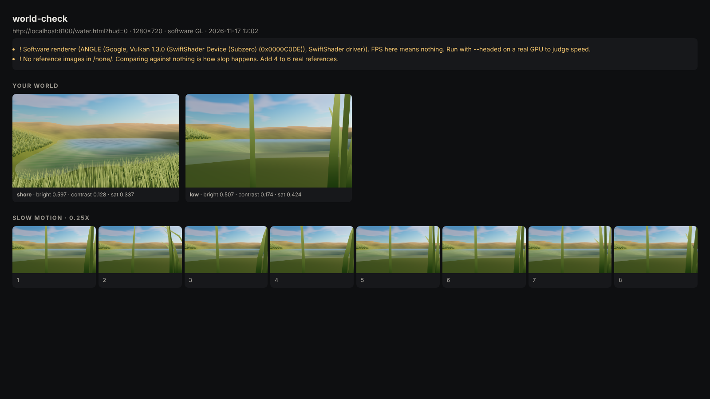
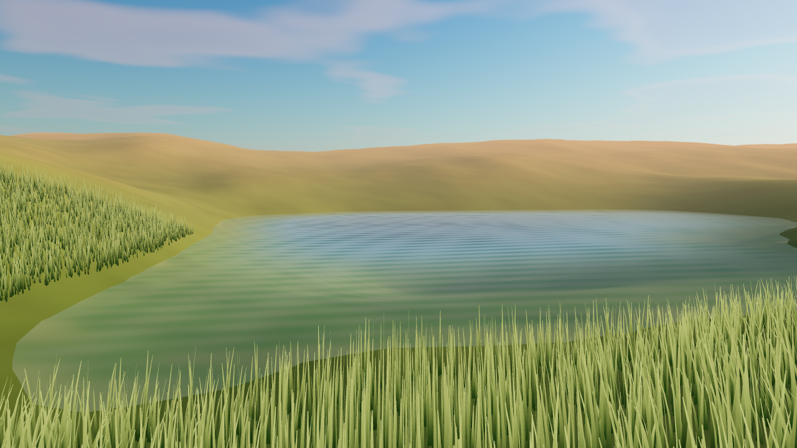

# world-taste

[](https://skills.sh/StarKnightt/world-taste)

**Your coding agent builds 3D worlds. This skill gives it taste.**

Ask Claude Code, Cursor or Codex for a 3D world and you usually get the same thing: flat light, one green, plastic water, a camera floating in the sky. world-taste fixes that with a process, not a list of tips. The agent picks an art direction, collects real reference photos, builds one system at a time, and then **opens the world in a real browser, screenshots it from fixed cameras, and compares it with the references** before it's allowed to call anything done.

<p align="center"></p>

<p align="center"><sub>Caught by the browser check while building this repo: round 1 had grass growing underwater, milky water and stripy waves. Round 2 fixed all three.</sub></p>

<p align="center"><a href="https://buymeacoffee.com/prasenx"></a>&nbsp;&nbsp;<a href="https://github.com/sponsors/StarKnightt"></a></p>

## Install

One command, for every agent. The [skills CLI](https://github.com/vercel-labs/skills) finds the agents you have (Claude Code, Cursor, Codex, Gemini CLI, Copilot and more) and installs the skill where each one looks.

```bash
npx skills add StarKnightt/world-taste
```

Then ask for a world:

> build a walkable misty pine valley at sunrise

The skill takes over from there.

<details>
<summary>Manual install</summary>

Copy `skills/world-taste` into your agent's skills folder, for example `~/.claude/skills/world-taste` for Claude Code, or `.cursor/skills/world-taste` in a project for Cursor.
</details>

## What happens when it runs

1. **Declare.** The agent writes down the place, the time of day, the one hero shot people will remember, the art direction and three dials: `REALISM`, `DENSITY`, `LIFE`.
2. **Art direction.** It picks one of [20 directions](skills/world-taste/references/art-directions.md) (golden hour coast, misty pine valley, summer festival at dusk, neon street after rain...). Each one comes with real numbers: sun angle, sun color, fog, exposure, palette, and the one detail that sells the look.
3. **References.** It collects 4 to 6 real photos of that kind of place, saves them in `refs/` with credits, and writes down what it sees in them ("shadows are blue, not grey").
4. **Build in order.** Terrain, sky and light, water, grass, trees, props, characters, audio, one system at a time, from [tested recipes](skills/world-taste/references/systems.md).
5. **Browser check.** After every system it runs `world-check`, which opens the world in Chromium, takes the same shots every time, measures them, and lays them next to the references. The agent fixes the biggest difference and runs it again. Two rounds per system, then it moves on or changes approach.
6. **Ship.** `?hud=0` recording mode, a hero spawn, README and credits.

It isn't done until there's proof: the final contact sheet, the hero shot next to its reference, and a slow-motion strip if anything moves.

## The browser check

<p align="center"></p>

```bash
node skills/world-taste/scripts/world-check.mjs --url http://localhost:5173
```

One script, one dependency (Playwright). It flags the things that make AI 3D look broken:

- blank frames, crashes and missing assets
- the camera under the terrain, or empty ground under the camera
- flat lighting, blown-out whites, crushed blacks
- one uniform green across every plant
- oversaturation, and anything far brighter, darker or flatter than your references
- rendering below full resolution
- animation that freezes or falls apart at 0.25x speed

The numbers catch broken renders. The contact sheet lets the agent's eyes catch the slop: wrong shadow color, plastic water, bad scale. More in [check.md](skills/world-taste/references/check.md).

## The dials

| Dial | 1 | 10 | Default |
|---|---|---|---|
| `REALISM` | flat toon, painted sky | photographic light and materials | 6 |
| `DENSITY` | sparse and open | lush and layered | 7 |
| `LIFE` | still diorama | wind, water, birds, people, everything moves | 6 |

Say it in plain words: *"realism 3, make it denser"*.

## What's inside

```
skills/world-taste/
├── SKILL.md                 the process, the rules, the slop list
├── references/
│   ├── art-directions.md    20 looks with sun, fog, exposure and palette numbers
│   ├── systems.md           tested three.js code: render, sky, terrain, water, grass, audio
│   ├── motion.md            characters, animals, riders, the slow-motion test
│   ├── check.md             how to wire and read the browser check
│   └── ship.md              recording, README and licenses
└── scripts/
    ├── world-check.mjs      the browser check
    └── world-taste-hook.js  drop-in fixed cameras for repeatable shots
examples/meadow-lake/        a small world built from the recipes
```

Try the example: `npx serve examples/meadow-lake`, then open `/?cam=shore`.

<p align="center"></p>

## Where this comes from

Twenty-plus browser worlds shipped in public: a Ghibli-style cycling road, a seaside boat ride, a fishing river, a tropical island, a summer festival, a horse ride through a mountain valley, and more. Most rules in the slop list are mistakes that made it into one of them first.

## Credits

- The builder-and-critic loop behind the browser check is [Matt Shumer](https://x.com/mattshumer_)'s gauntlet loop.
- The brief → direction → verify structure was inspired by [Leon Lin](https://github.com/Leonxlnx)'s [Taste Skill](https://github.com/Leonxlnx/taste-skill) for frontend design. world-taste brings the idea to 3D worlds and adds a working visual check.
- Built by [Prasenjit Nayak](https://prasen.dev) ([@prasenx](https://x.com/prasenx)).

MIT licensed. Issues and pull requests welcome, especially new art directions with real reference photos.

<p align="center">
  <a href="https://buymeacoffee.com/prasenx"></a>&nbsp;&nbsp;
  <a href="https://github.com/sponsors/StarKnightt"></a>
</p>
